

# ISSAKHA SALL
### **Data Scientist & Ingénieur LLM**
*Consultant Freelance • Architectures Multi-Agents • GraphRAG & RAG Avancé • Data Engineering*

 

 

> **"Je conçois des solutions Data & IA orientées impact opérationnel : architectures multi-agents autonomes, systèmes GraphRAG, pipelines de streaming continus, entrepôts Medallion et modèles décisionnels prédictifs."**

---

### 💼 Domaines d'Intervention & Expertise

<table>
  <tr>
    <td width="33%" align="center">
      <h3>🤖 IA Générative, Agents & GraphRAG</h3>
      
Systèmes multi-agents autonomes, architectures GraphRAG combinant graphes de connaissances et recherche vectorielle, et serving local de LLMs.

      <b>Outils :</b> LangChain • LangGraph • CrewAI • Neo4j • ChromaDB • vLLM • Ollama • LM Studio
    </td>
    <td width="33%" align="center">
      <h3>📊 Data Engineering & Streaming</h3>
      
Architecture Medallion (Bronze/Silver/Gold), modélisation Star Schema, pipelines ETL/ELT distribués, streaming temps réel et moteurs d'audit qualité automatisés.

      <b>Outils :</b> Apache Kafka • Apache Airflow • Crawl4AI • PostgreSQL • MongoDB • Docker • Parquet
    </td>
    <td width="33%" align="center">
      <h3>👁️ Machine Learning & Vision</h3>
      
Modélisation prédictive financière, scoring de crédit, vision par ordinateur temps réel (FER) et OCR intelligent de documents.

      <b>Outils :</b> PyTorch • Scikit-Learn • OpenCV • MLflow • FastAPI
    </td>
  </tr>
</table>

---

### 🛠️ Stack Technique

#### **Programmation, Frameworks Web & Bases de Données (SQL / NoSQL / Graphes)**

  

  
  
  

#### **Écosystème GenAI, LLMs, GraphRAG & Inférence Locale**

  
  
  
  
  
  
  
  
  

#### **Data Science, Pipelines Data, Cloud & MLOps**

  

  
  
  
  
  
  

---

### 🚀 Projets Phares & Réalisations

<table>
  <!-- LIGNE 1 -->
  <tr>
    <td width="33%" valign="top">
      <a href="https://github.com/Issa17398/French_energy">
        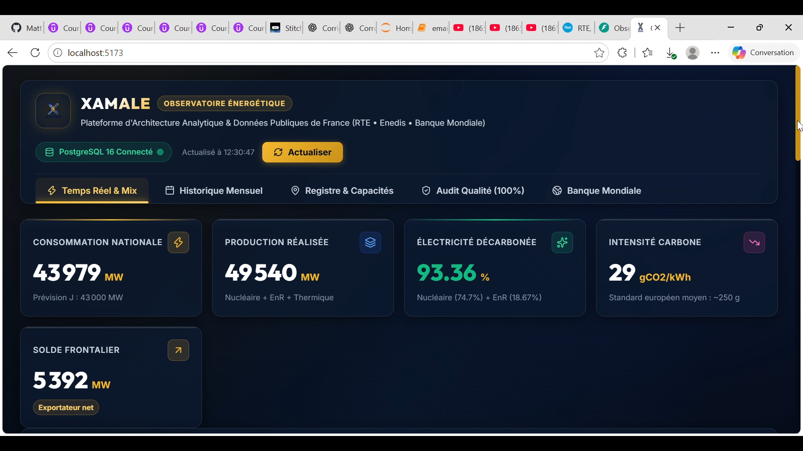
      </a>
      <h4>⚡ <a href="https://github.com/Issa17398/French_energy">XamaleEnergy</a> </h4>
      
<b>Data Engineering • Medallion • Star Schema</b>

      
Observatoire des données énergétiques françaises (RTE, Enedis). Pipeline Bronze/Silver/Gold en Parquet, audit qualité 100% PASS, API FastAPI et dashboard React 19.

      

        
        
        
        
      

    </td>
    <td width="33%" valign="top">
      <a href="#-projets-sous-accord-de-confidentialité-privés">
        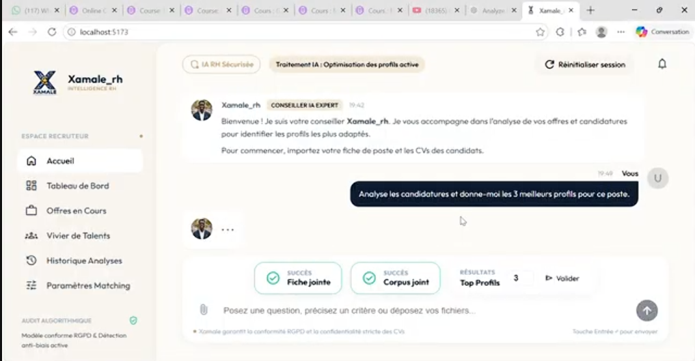
      </a>
      <h4>🤖 <a href="#-projets-sous-accord-de-confidentialité-privés">Xamale RH</a> </h4>
      
<b>LLM • Multi-Agents • RAG</b>

      
Assistant de recrutement intelligent automatisant l'analyse comparative entre offres d'emploi et CV par similarité sémantique[cite: 13].

      

        
        
        
      

    </td>
    <td width="33%" valign="top">
      <a href="#-projets-sous-accord-de-confidentialité-privés">
        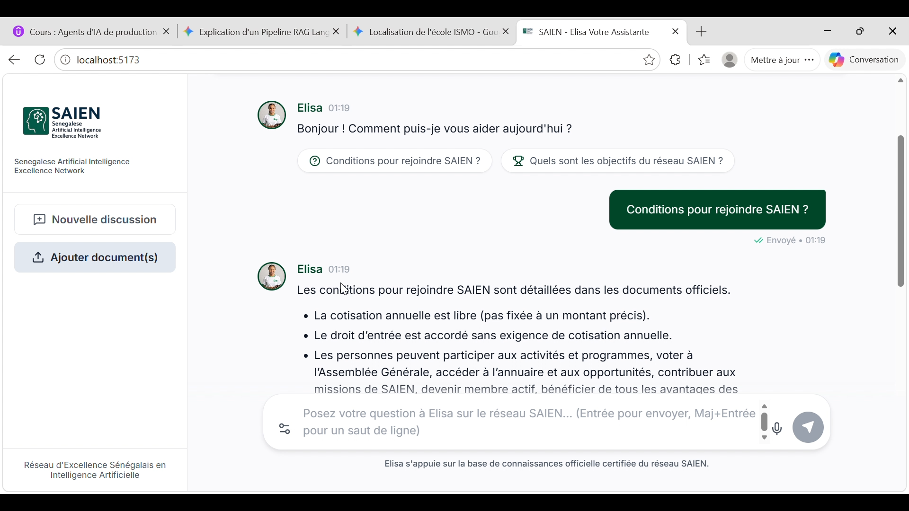
      </a>
      <h4>🧠 <a href="#-projets-sous-accord-de-confidentialité-privés">Assistance-faq</a> </h4>
      
<b>RAG Pédagogique</b>

      
Moteur de recherche contextuel et d'assistance pédagogique répondant aux interrogations à partir de supports de cours[cite: 13, 18].

      

        
        
        
      

    </td>
  </tr>

  <!-- LIGNE 2 -->
  <tr>
    <td width="33%" valign="top">
      <a href="https://github.com/Issa17398/Projet_DeepLearning_FER">
        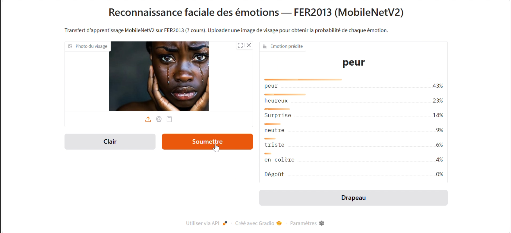
      </a>
      <h4>👁️ <a href="https://github.com/Issa17398/Projet_DeepLearning_FER">DeepLearning FER</a> </h4>
      
<b>Computer Vision</b>

      
Système de détection et reconnaissance des émotions faciales en temps réel via des réseaux neuronaux convolutionnels[cite: 17].

      

        
        
        
      

    </td>
    <td width="33%" valign="top">
      <a href="https://github.com/Issa17398/Projet_Approbation_pret">
        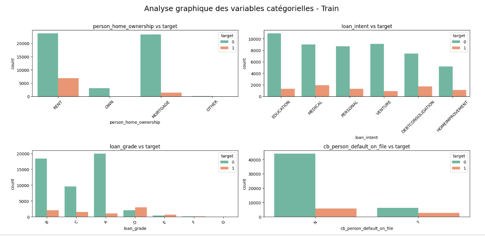
      </a>
      <h4>📊 <a href="https://github.com/Issa17398/Projet_Approbation_pret">Approbation de Prêt</a> </h4>
      
<b>Machine Learning & Risk</b>

      
Modèle décisionnel pour l'évaluation du risque de défaut et l'aide à l'octroi de crédits bancaires[cite: 17].

      

        
        
        
      

    </td>
    <td width="33%" valign="top">
      <a href="https://github.com/Issa17398/Projet_Point_BI">
        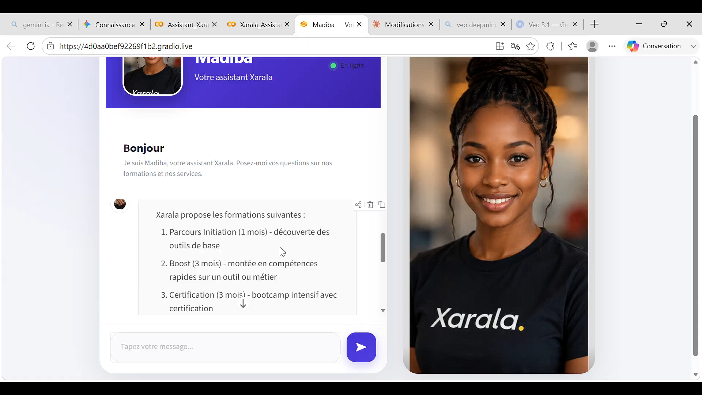
      </a>
      <h4>📈 <a href="https://github.com/Issa17398/Projet_Point_BI">Projet Power BI</a> </h4>
      
<b>Business Intelligence</b>

      
Pipelines de traitement de données commerciales, indicateurs KPI et tableaux de bord analytiques pour le pilotage d'activité[cite: 17].

      

        
        
        
      

    </td>
  </tr>

  <!-- LIGNE 3 -->
  <tr>
    <td width="33%" valign="top">
      <a href="https://issakha-sallportfolio.vercel.app" target="_blank">
        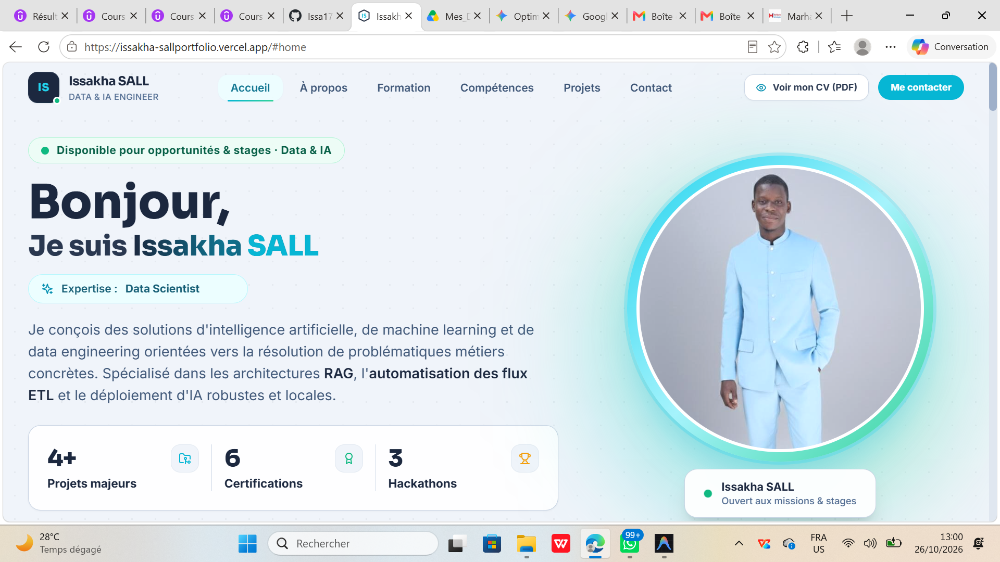
      </a>
      <h4>🌐 <a href="#-projets-sous-accord-de-confidentialité-privés">Mon Portfolio</a> </h4>
      
<b>Frontend & Design Web</b>

      
Interface interactive et réactive valorisant mes compétences, mes projets en intelligence artificielle et mes coordonnées[cite: 18].

      

        
      

      

        
        
        
      

    </td>
    <td width="33%" valign="top">
      <a href="https://github.com/Issa17398/XamaleScrape">
        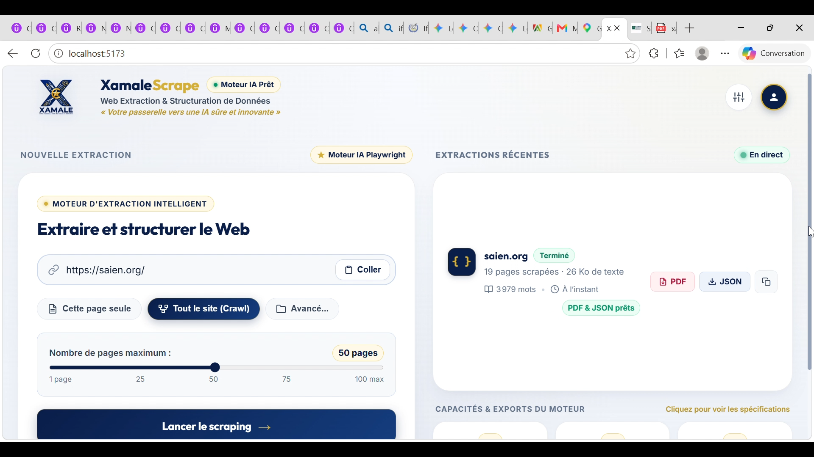
      </a>
      <h4>⚡ <a href="https://github.com/Issa17398/XamaleScrape">XamaleScrape</a> </h4>
      
<b>Data Ingestion & LLM Ready</b>

      
Moteur d'extraction web asynchrone conçu pour transformer le contenu non structuré en données exploitables par des LLMs[cite: 18].

      

        
        
        
      

    </td>
    <td width="33%" valign="top">
      <a href="https://github.com/Issa17398/Web_Scraping">
        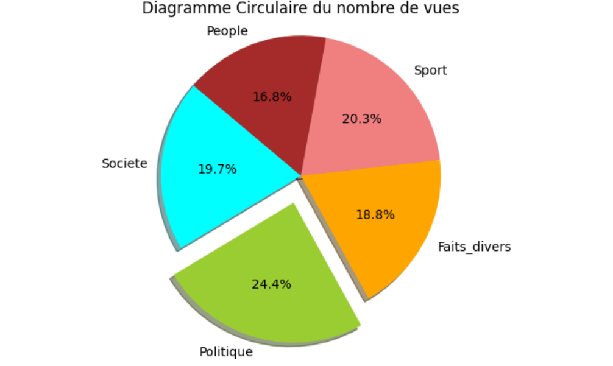
      </a>
      <h4>🕷️ <a href="https://github.com/Issa17398/Web_Scraping">Scraping Seneweb</a> </h4>
      
<b>NLP & Pipeline Média</b>

      
Collecte automatisée d'articles de presse, analyse thématique de l'actualité et structuration dans une base de données documentaire.

      

        
        
        
      

    </td>
  </tr>

  <!-- LIGNE 4 -->
  <tr>
    <td width="33%" valign="top">
      <a href="https://marhabanetechnologies.com" target="_blank">
        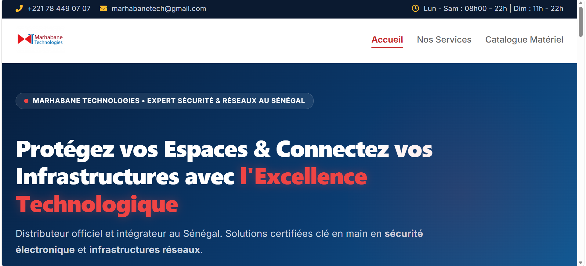
      </a>
      <h4>🏢 <a href="#-projets-sous-accord-de-confidentialité-privés">Marhabane Technologie</a> </h4>
      
<b>Solutions Digitales & Web</b>

      
Plateforme web de présentation de services technologiques connectée à des endpoints de gestion automatisée[cite: 18].

      

        
      

      

        
        
        
      

    </td>
    <td width="33%" valign="top">
      <a href="https://senegalaudiovisuel.streamlit.app/" target="_blank">
        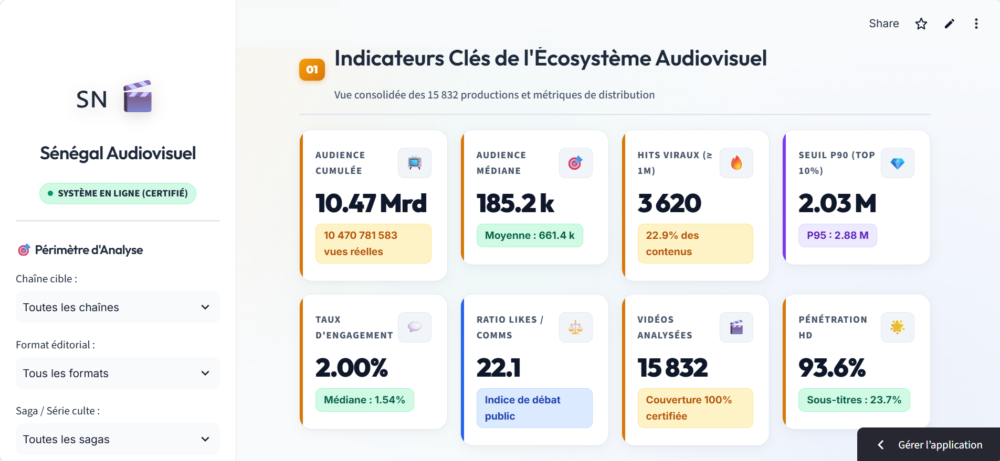
      </a>
      <h4>📊 <a href="https://github.com/Issa17398/Plateforme_Decisionnelle_MLOps">Plateforme_Decisionnelle_MLOps</a> </h4>
      
<b>MLOps & Analytics Audiovisuel</b>

      
Plateforme décisionnelle d'analyse et de suivi des données du secteur audiovisuel sénégalais déployée en production.

      

        
      

      

        
        
        
      

    </td>
    <td width="33%" valign="top"></td>
  </tr>
</table>

---

### 🔒 Projets sous Accord de Confidentialité (Privés)

> Les dépôts **Xamale RH**, **Assistance-faq**, **Mon_Portfolio** et **Marhabane_technologie** sont configurés en accès privé pour des impératifs contractuels, de protection de code propriétaire ou d'intégration de clés d'API métier[cite: 18].  

---

### 📈 Activité & Statistiques

  
  

---

### 🤝 Disponibilité & Contact

Je suis disponible pour des **missions de consulting**, de la conception d'**architectures IA avancées (LLMs/Agents/GraphRAG)** ou des **renforts Data Engineering** :

 

📍 **Keur Massar, Dakar, Sénégal** *(Disponible sur site & en télétravail international)*[cite: 13]  
📬 **Email pro :** [issakha.sall@univ-thies.sn](mailto:issakha.sall@univ-thies.sn)[cite: 13]  
💼 **LinkedIn :** [linkedin.com/in/issakha-sall](https://linkedin.com/in/issakha-sall)[cite: 13]

